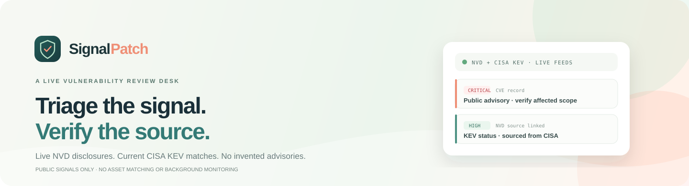
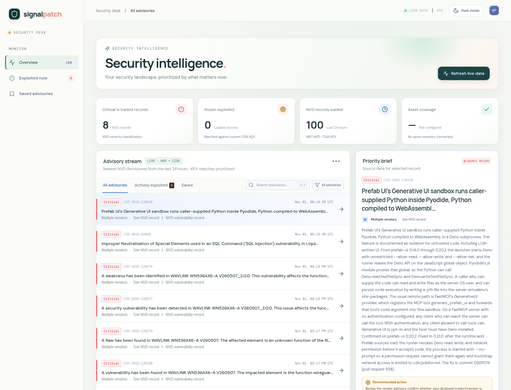

<div align="center">
  <a href="https://goutham-valugula.github.io/SignalPatch/">
    
  </a>

  <p><strong>A live vulnerability review desk for small IT teams.</strong><br />Fresh NVD records, matched against CISA's Known Exploited Vulnerabilities catalog.</p>

  <p>
    <a href="https://goutham-valugula.github.io/SignalPatch/"><strong>↗ Open SignalPatch</strong></a>
    &nbsp;·&nbsp;
    <a href="#run-locally">Run locally</a>
    &nbsp;·&nbsp;
    <a href="https://github.com/goutham-valugula/SignalPatch/issues">Report an issue</a>
  </p>

  <p>
    
    
    
    <a href="LICENSE"></a>
  </p>
</div>

## See the live review desk

<a href="https://goutham-valugula.github.io/SignalPatch/"></a>

*Interface preview. Advisory records load from NVD and CISA in the browser; the preview image is illustrative of the interface, not a live feed.*

## Prioritize what to verify

SignalPatch brings recent vulnerability disclosures and known-exploitation signals into one readable review surface. Open a record, inspect its source and listed product scope, then decide what your team should verify. It is a triage aid—not an asset scanner or a verdict that a system is vulnerable.

### What happens when you open it

1. The browser requests NVD CVEs published in the last 24 hours (up to 100 records).
2. It fetches the current CISA KEV catalog and matches its CVE IDs against those NVD records.
3. You can filter, search, save records locally in the current page, and open the NVD record for source review.
4. For a live record, prepare a source-linked broadcast draft to copy and review. SignalPatch does not send it.

There are **no sample or fallback vulnerability records**. If either public source cannot be fetched, the dashboard clears the list and displays the error so old results cannot look current.

## A calmer security desk

- **Warm, readable workspace:** an editorial light theme with mint, evergreen, and coral accents, plus a dark-mode toggle.
- **Live-source state:** refresh time, feed status, live record counts, CISA KEV matches, and an explicit unavailable/error state.
- **Evidence at hand:** CVE source links and NVD-listed product/version scope where available.
- **Useful review tools:** search, severity filter, exploited-only view, saved view, and copyable draft for human review.
- **Responsive layout:** use the same dashboard on desktop and narrower screens.

## Run locally

Requires Node.js and npm.

```sh
git clone https://github.com/goutham-valugula/SignalPatch.git
cd SignalPatch
npm ci
npm run dev
```

Open the local URL printed by Vite. A production build is available with:

```sh
npm run build
npm run preview
```

SignalPatch is a static React/Vite app. NVD and CISA requests are made by the visitor's browser; no SignalPatch account, API key, backend, or automatic background polling is required.

## Sources and limitations

- [NIST National Vulnerability Database API](https://services.nvd.nist.gov/rest/json/cves/2.0) — recent CVE records and available CVSS/CPE details.
- [CISA Known Exploited Vulnerabilities catalog](https://www.cisa.gov/known-exploited-vulnerabilities-catalog) — exploitation-in-the-wild signal, fetched from [CISA's public data mirror](https://github.com/cisagov/kev-data).
- Direct browser requests depend on source availability, CORS, and rate limits. If a request fails, the current view reports that and shows no cached or sample records.
- Only up to 100 NVD records from the previous 24 hours are requested. This is not a complete feed or continuous monitoring service.
- NVD CPE scope can be absent or incomplete. A listed product is not proof that your installed version is affected.
- No asset inventory is connected; SignalPatch does not determine exposure, assign organization-specific risk, or replace vendor advisories and incident response.
- The optional n8n workflow starter in [`workflows/`](workflows/) is inactive and is not used by the live dashboard. No Telegram channel is connected and no messages are sent.

## Built with

React · TypeScript · Vite · lucide-react

## License

[MIT](LICENSE)
